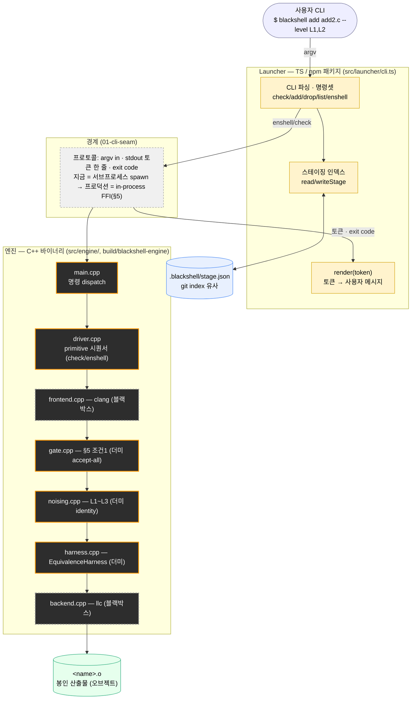
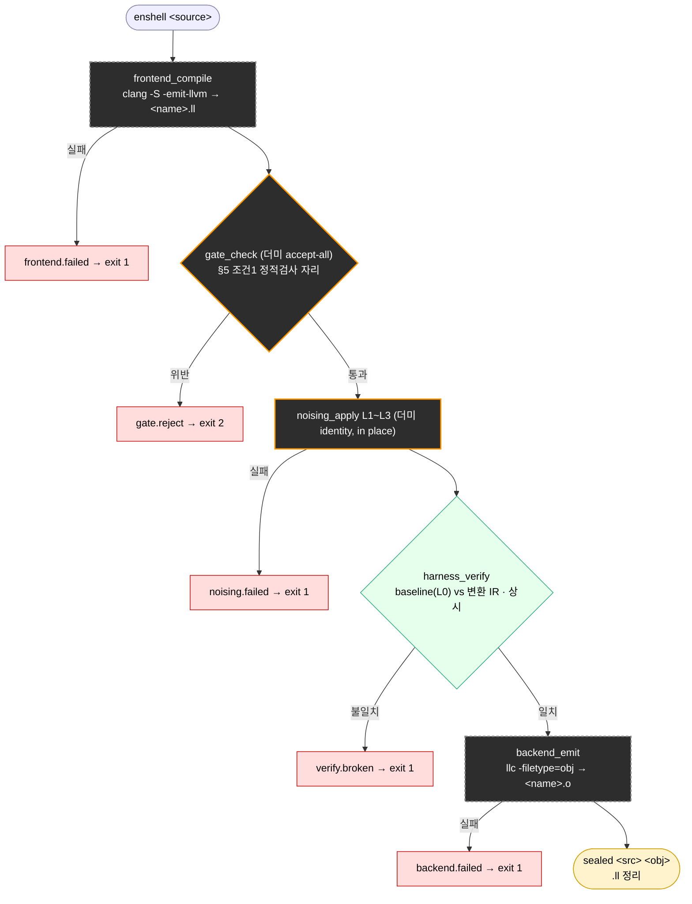
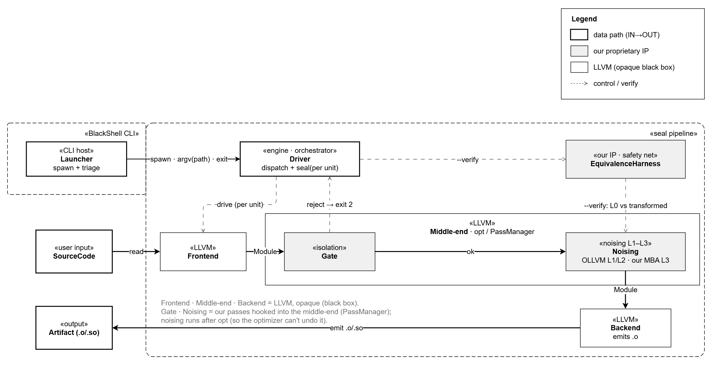

# BlackShell 아키텍처

> §1~4 = 현재 구현, §5~6 = 프로덕션 목표. 계층 계약은 [interfaces/](interfaces/), 장기 설계는
> [BlackShell_Plan.md §6](BlackShell_Plan.md).

---

## 1. 계층 개요

**외부는 TS Launcher, 실행은 C++ 엔진.** Launcher(`src/launcher/cli.ts`)가 CLI·명령셋·스테이징·렌더를
소유하고, 유닛마다 엔진 바이너리를 서브프로세스로 띄워 primitive(`check`/`enshell`)를 호출한다. 엔진은
구조화된 토큰 한 줄 + exit code만 돌려주고, 사용자 메시지 렌더는 Launcher가 한다.

**그림 1. 컴포넌트 계층.** 노랑 = Launcher, 점선 = 경계, 주황 테두리 = 우리 IP primitive,
점선 테두리 = LLVM 블랙박스(clang/llc). IR(LLVM `.ll`)은 엔진 안 primitive 사이를 **파일 경로**로 오간다.

---

## 2. enshell 파이프라인

봉인 본체(`driver_enshell`). 순서 고정 — `clang → gate → noising → harness → llc → artifact`. 모든 단계가
같은 계약(IR 파일 경로 in/out)을 지켜 더미 primitive를 실제로 교체해도 드라이버는 안 바뀐다. 등가검증은
플래그가 아니라 상시 내장.

**그림 2. enshell 파이프라인.** 게이트 = 노이징 앞 go/no-go, harness = 노이징 뒤 안전망. Launcher의
`enshell`이 스테이징된 유닛마다 엔진 `enshell`을 한 번씩 호출하고 완료 후 스테이징을 비운다(1-shot).

---

## 3. 핵심 설계 원칙

- **경계** — Launcher가 명령셋을 소유, 엔진엔 `[subcommand, path]` argv만 넘긴다. 엔진은 토큰 + exit
  code만, 렌더는 Launcher(`render()`). (`interfaces/01-cli-seam.md`)
- **primitive 계약** — 시그니처는 `src/engine/engine.hpp`. 각 primitive는 `.cpp` 하나라, 더미↔실제 교체
  시 드라이버·다른 primitive를 안 건드린다. (`interfaces/04-pass-contract.md`)
- **더미 상태** — 우리 IP(게이트·노이징·하네스)는 전부 더미. identity noising = "맞지만 보호 안 됨",
  **accept-all gate = 출하 전 반드시 교체**.
- **구조적 격리 (§5 조건1)** — 외부 메모리 공유를 게이트가 판정하는 자리(현재 더미). (`interfaces/03-ir-model.md`)
- **등가 검증** — baseline(L0) vs 변환을 컴파일·실행해 관측 출력만 비교. 샘플 기반이라 반례 부재이지 증명은
  아니다. (`interfaces/05-verification-harness.md`)

---

## 4. 명령 → 구현 매핑

**Launcher 명령** (`src/launcher/cli.ts`):

| 명령 | 역할 | 구현 |
| --- | --- | --- |
| `check <source>` | 게이트 판정만(미리보기) | `cmdCheck` → 엔진 `check` |
| `add <source> [--level L]` | 유닛 스테이징 (레벨 기록) | `cmdAdd` |
| `drop <source>` | 언스테이징 | `cmdDrop` |
| `list` | 스테이징 목록 | `cmdList` |
| `enshell` | 스테이징 전체 봉인 → 오브젝트 | `cmdEnshell` → 유닛마다 엔진 `enshell` |
| `help` / `-h` / 빈 argv | 사용법 | `USAGE` |
| `-v` / `--version` | 버전(엔진 없이 즉답) | `package.json` |

**엔진 subcommand** (`src/engine/`): `check` → `driver_check`(게이트만), `enshell` → `driver_enshell`(전체).

exit 코드: `0` 정상 · `1` 오류 · `2` 게이트 거부 · `127` 엔진 없음(Launcher가 설정).

> ⚠️ **현재 갭:** `add`의 레벨(기본 `L3`)은 스테이징에 저장되지만 엔진 호출(`enshell <path>`)에 아직
> 전달 안 함. 노이징이 레벨 무관 더미라 무해 — 실제 노이징 넣을 때 레벨 배선 필요. (`interfaces/02-driver.md`)

---

## 5. 프로덕션 언어 경계 (목표 — 하이브리드)

세 역할로 나눈다:

- **엔진 primitive (RISC).** 불러오기·게이트·노이징·검증·방출 각각 한 가지 직교 동작만 하고 순서를
  가정하지 않는다. IR/LLVM·파일 I/O는 전부 엔진 안.
- **엔진 Driver (시퀀서).** 유닛별 봉인 파이프라인(고정 순서)을 엔진 안에서 구동. IR은 파이프라인 내내
  엔진에 머문다.
- **Launcher (TS).** CLI 파싱 + 명령·레벨 조합 + 메시지 렌더. 엔진엔 plan(경로·레벨·플래그)을 넘기고
  결과(판정·아티팩트·에러)를 받는다.

**경계 규율.** Launcher↔엔진으로 IR 값은 넘지 않는다 — plan in, 구조화된 결과 out. CLI 호출 간 유닛
참조가 필요하면 IR이 아니라 불투명 핸들로(파일 디스크립터 비유). 전제는 in-process FFI(공유 라이브러리).

**확장 규칙.** CLI 옵션 추가 시 — (a) 기존 primitive 재조합이면 Launcher만 수정, (b) 새 동작이면 엔진에
primitive 추가(드물어야 정상). 성립 전제 = primitive가 직교적일 것.

---

## 6. 프로덕션 설계 (목표)

LLVM 프론트엔드·미들엔드·백엔드는 **블랙박스**로 두고, 우리 IP와 계약만 명시한다.

**그림 3. 프로덕션 아키텍처.** 두 경계 — `«BlackShell CLI»`(Launcher)와 `«Engine · C++»`. 데이터패스
`SourceCode(IN) → Frontend → Gate → Noising → Backend → Artifact(.o/.so, OUT)`, 엔진 내부 `Driver`가
유닛별로 구동. `Gate·Noising`은 LLVM 미들엔드(opt·PassManager)에 훅으로 걸린 우리 패스(노이징은 opt 뒤).
해칭 = LLVM 블랙박스, 회색 = 우리 IP(Gate·Noising·EquivalenceHarness). 원본: `BlackShell.drawio`(미커밋).

**교체점.** 회색 박스 둘 — **게이트**(판정만, §5 조건1)와 **노이징**(의미 보존 변환). 더미(accept-all
게이트·항등 노이징)를 실제로 교체하며, 노이징은 L1·L2 = OLLVM 포크, L3 = 우리 carry-sensitive MBA.

### 지금(스켈레톤) → 프로덕션 매핑

| 지금 (스켈레톤) | 프로덕션 | 성격 |
| --- | --- | --- |
| 명령셋·CLI·조합·렌더 = **Launcher**(TS) | **Launcher** | 이미 Launcher |
| 봉인 시퀀싱 = 엔진 **Driver** | 엔진 **Driver** | 엔진 유지 |
| 프론트엔드 = clang (`.ll`) | 프론트엔드 소스→IR | LLVM 블랙박스 |
| 더미 게이트 (accept-all) | 격리 게이트 (§5 조건1) | **우리 IP** |
| 더미 항등 노이징 | 노이징 (OLLVM L1/L2 + MBA L3) | **L3는 우리 IP** |
| 더미 등가검증 | 등가 하네스 (컴파일·실행) | **우리 IP** |
| 백엔드 = llc (`.o`) | 백엔드 아티팩트 emit | LLVM 블랙박스 |
