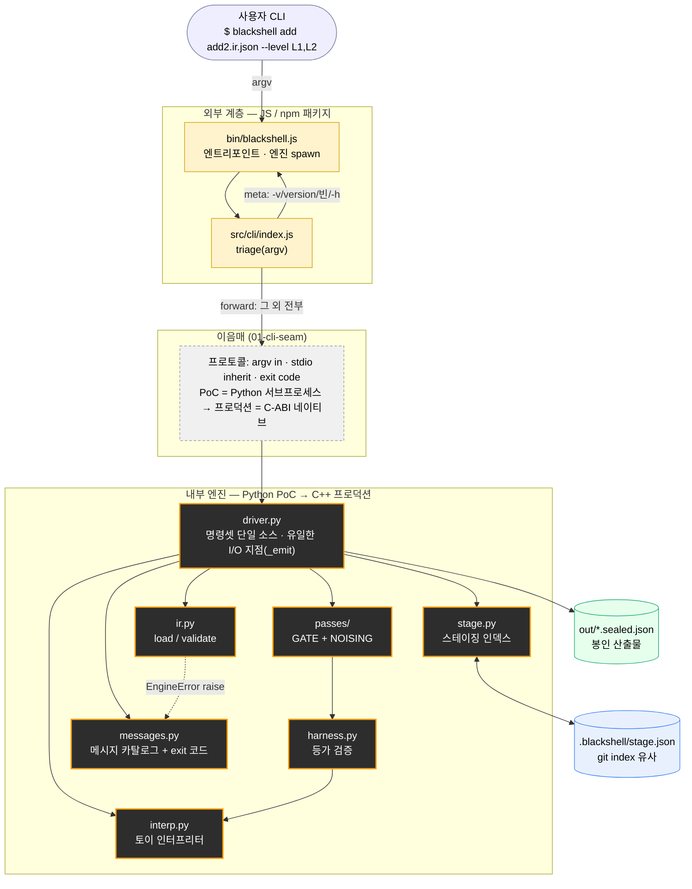
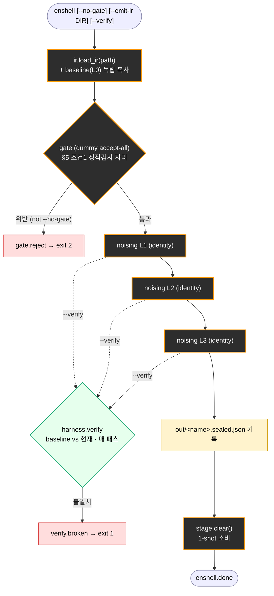

# BlackShell 아키텍처

작성일: 2026-11-04 · 개정: 2026-11-07 (§5·§6 프로덕션 모델 — 하이브리드: RISC primitive + 엔진 Driver)

> 현재 **PoC 스켈레톤**의 실제 구현 구조를 기록한다. 장기 LLVM 파이프라인 설계는
> [BlackShell_Plan.md §6](BlackShell_Plan.md)을, 이음매 계약은
> [interfaces/](interfaces/)를 참고.

> ⚠️ **2026-11-08 구현 전환:** PoC가 **Python 토이 엔진 → TS 런처 + C++ 엔진**으로 교체됐다
> (실제 `clang`/`llc` 컴파일 + 더미 게이트·항등 노이징). 현재 코드 = `src/launcher/cli.ts` +
> `src/engine/main.cpp`. **아래 §1~4와 `interfaces/`는 제거된 Python 토이 PoC를 설명하므로
> 재동기화 대기 중**이다. 하이브리드 언어 경계는 §5, 목표 설계는 §6이 최신본.

---

## 1. 계층 개요

외부 계층(JS/npm)은 패키징이 소유한 것만 응답하고, 나머지는 전부 내부 엔진으로
넘긴다. 이음매 프로토콜(argv in · stdio inherit · exit code 전파)이 고정이라
PoC Python 엔진을 프로덕션 C-ABI 네이티브 바이너리로 교체해도 JS는 바뀌지 않는다.

**그림 1. 컴포넌트 계층.** 노랑 = JS 외부 계층(패키징 소유), 점선 = 외부/내부 이음매,
주황 테두리(검정 배경) = 우리가 작성한 내부 엔진, 파랑/초록 = 상태·산출물.

---

## 2. enshell 파이프라인

봉인 본체. 순서는 고정이다 — `load → gate → noising L1→L2→L3 → emit`. 각 유닛은
자신이 선택한 레벨만 거치고, 모든 단계가 동일한 IR 계약을 지키므로 더미 패스를
실제 패스로 교체해도 드라이버는 바뀌지 않는다.

**그림 2. enshell 파이프라인.** 게이트는 노이징 앞의 go/no-go, 등가 검증(`--verify`)은
변환 전체를 가로지르는 안전망. 봉인이 끝나면 스테이징은 소비되어 비워진다.

---

## 3. 핵심 설계 원칙

- **외부/내부 이음매** — JS는 `version`·usage 같은 *패키징이 소유한 것*만 로컬
  응답하고 나머지는 엔진에 그대로 전달한다. 명령셋 파싱을 안 하므로 엔진이
  명령셋의 단일 소스이고, 이음매 프로토콜이 고정이라 PoC→프로덕션 교체 시 JS는
  무변경이다. (`interfaces/01-cli-seam.md`)
  (⚠️ 이건 현재 PoC 기준이다. 2026-11-07 재배치로 **프로덕션에선 명령셋·조합이 Launcher로
  이동**해 JS가 오히려 두꺼워진다 → §5.)
- **패스 계약** — `noising: IR→IR`, `gate: IR→Verdict` 두 시그니처. 현재는 전부
  더미다(identity noising = "맞지만 보호 안 됨", accept-all gate = **출하 전 반드시
  교체**). 더미↔실제 교체 시 드라이버는 안 건드리고 레지스트리 엔트리만 swap한다.
  (`interfaces/04-pass-contract.md`)
- **단일 I/O 지점** — 파이프라인 코드(`ir`/`interp`/`passes`)는 절대 print하지 않고
  `EngineError`를 raise만 한다. 렌더링은 `driver._emit` 한 곳, 메시지/스트림/exit
  코드는 `messages.py` 카탈로그에서 조회한다. (`interfaces/02-driver.md`)
  (프로덕션에선 렌더가 Launcher로 가고, 엔진 primitive는 구조화된 verdict·에러코드만
  반환한다 → §5.)
- **구조적 격리 (§5 조건1)** — IR에 포인터·전역·I/O가 표현 불가능하므로 격리가
  문법 수준에서 강제된다. (`interfaces/03-ir-model.md`)
- **등가 검증** — baseline(L0)과 변환 결과를 같은 입력으로 돌려 관측 출력(`returns`)만
  비교한다. 내부 레지스터·명령어 수·경로는 노이징이 바꾸는 것이라 비교하지 않는다.
  샘플 기반이라 반례의 부재이지 등가 증명은 아니다. (`interfaces/05-verification-harness.md`)

---

## 4. 명령 → 모듈 매핑

| 명령 | 역할 | 주 사용 모듈 |
| --- | --- | --- |
| `check <ir>` | 게이트 판정만(스테이징 전 미리보기) | `ir`, `passes.GATE` |
| `add <ir> [--level L]` | 유닛을 스테이징 | `ir`, `stage` |
| `drop <ir>` | 언스테이징 | `stage` |
| `list` | 스테이징 목록 | `stage` |
| `enshell [...]` | 스테이징 전체 봉인 → 아티팩트 | `ir`, `passes`, `harness`, `stage` |
| `run <ir> [--input k=v]` | 토이 인터프리터로 유닛 실행 | `ir`, `interp` |
| `help` / 빈 argv | 사용법 | `driver.USAGE` |

exit 코드: `0` 정상 · `1` 오류 · `2` 게이트 거부(BlackShell_Plan §5 조건1) · `127` 엔진 없음(JS가 설정).

---

## 5. 프로덕션 언어 경계 (2026-11-07 — RISC 엔진 + 엔진 Driver, 하이브리드)

> 아래는 **설계 철학**이다(구현 전이라 구체 primitive·함수·시그니처 이름은 확정하지 않는다).
> 2026-11-04 "두꺼운 엔진"안의 근거는 이 절 끝 "설계 이력"에 보존한다.

**핵심: RISC(직교 primitive)와 Driver의 존재는 충돌하지 않는다.** RISC가 요구하는 건 *명령(primitive)이
직교적일 것*이지 *시퀀서가 어디 사는지*가 아니다. MIPS도 직교 명령셋 위에 그 명령을 순서대로 흘리는
시퀀서가 있고 — Driver가 바로 그 자리다. 그래서 엔진은 **직교 primitive + 그걸 엮는 Driver**를 함께
갖고, 그 위에서 Launcher는 **CLI·명령 조합**을 맡는다.

**세 역할:**
- **엔진 primitive (RISC).** 불러오기·게이트·노이징·검증·방출 류의 각 primitive는 한 가지 직교 동작만
  하고 서로의 순서를 가정하지 않는다. IR/LLVM·파일 I/O는 전부 엔진 안.
- **엔진 Driver (시퀀서).** 유닛별 봉인 파이프라인(고정 순서: 불러오기→게이트→노이징→검증→방출)을
  엔진 안에서 구동한다 — primitive를 순서대로 호출하는 '프로그램'. IR은 이 파이프라인 내내 엔진
  메모리에 머문다.
- **Launcher (JS/TS).** CLI 파싱 + 어떤 명령·옵션·유닛·레벨인지 결정(명령 레벨 조합) + 사용자 메시지
  렌더(UX). 엔진엔 "무엇을 봉인할지"(경로·레벨·플래그 = plan)를 넘기고 결과(판정·아티팩트·에러)를 받는다.

**경계 규율 (핸들 ABI는 CLI 경계에만).** Launcher↔엔진 경계로는 IR 값이 넘어가지 않는다 — plan(경로·
레벨·플래그) in, 구조화된 결과(판정·아티팩트 경로·에러) out. 봉인 파이프라인이 통째로 엔진 안에서
돌기 때문에 IR은 애초에 경계를 안 넘는다. (유닛을 CLI 호출 간에 참조해야 하면 IR이 아니라 불투명
핸들로 — OS 파일 디스크립터 비유.) 전제는 in-process FFI(엔진 = Node에 로드되는 공유 라이브러리,
선례 better-sqlite3·libLLVM 바인딩); 바인딩 방식은 구현 시 확정.

**옛 모델 대비 달라지는 것.** 2026-11-04안은 Launcher를 "거의 forward만" 하는 얇은 껍데기로 봤다.
하이브리드는 **명령셋·CLI 파싱·명령 조합·메시지 렌더를 Launcher로 올린다.** 반면 봉인 파이프라인
시퀀싱과 IR/LLVM·파일 I/O는 엔진(Driver+primitive)에 그대로 둔다. 요지는 "실행·시퀀싱은 엔진,
CLI·조합·UX는 Launcher" — **Driver 삭제가 아니라 역할 재분배.**

**확장 계약 — CLI 옵션 추가.** 두 경로 — **(a)** 기존 엔진 능력의 재조합(다른 유닛·레벨·플래그·명령
구성)이면 → Launcher만 수정. **(b)** 파이프라인에 없던 새 동작이 필요하면 → 엔진에 primitive 추가
(드물어야 정상). 성립 전제 = primitive가 **직교적**일 것(숨은 순서 의존 금지, 하나가 두 동작 묶지
말 것). 그래야 엔진 Driver가 자유롭게 재배선하고 Launcher가 명령 레벨에서 조합할 수 있다. ⚠️ 깨지는
지점은 primitive가 순서·명령을 암묵 가정할 때다 — 그 순간 (a)가 (b)로 새어 옵션 하나에 엔진까지
건드리게 된다.

### 설계 이력 (2026-11-04 → 11-07)

> **2026-11-04 (두꺼운 엔진):** 얇은 JS 론처 + 엔진 전체 C++ 인프로세스, 드라이버·스테이징·명령셋
> 전부 엔진 소유. **2026-11-07 (하이브리드):** 엔진은 RISC primitive + Driver 시퀀서를 유지하되,
> 명령셋·CLI 파싱·명령 조합·메시지 렌더를 Launcher로 올림. Driver 삭제가 아니라 역할 재분배다.
> 상세 diff는 git 이력 949b11e를 참조.

---

## 6. 프로덕션 설계 (목표)

위 §1~4가 현재 **PoC 스켈레톤**이라면, 이 절은 LLVM 프로덕션 **목표 구조**다
([BlackShell_Plan.md §6](BlackShell_Plan.md), 모델 P · C-ABI 이음매). LLVM
프론트엔드·미들엔드·백엔드는 **블랙박스 파사드**로 두고, 우리 IP와 계약(패스 계약 · 경계 규율 ·
엔진(Driver+primitive) ↔ Launcher 역할 분담)만 명시한다.

**그림 3. 프로덕션 아키텍처 (정본).** 두 경계 — `«BlackShell CLI»`(JS Launcher) 와
`«Engine · C++ — seal pipeline»`(C++ 엔진). 데이터패스 `SourceCode(IN) → Frontend → Gate →
Noising → Backend → Artifact(.o/.so, OUT)`, 엔진 내부 `Driver`가 유닛별로 이 파이프라인을 구동.
`Gate·Noising`은 **LLVM 미들엔드(opt·PassManager)에 훅으로 걸린 우리 패스**다(노이징은 opt 뒤).
해칭 = LLVM 블랙박스(Frontend·Middle-end·Backend), 회색 = 우리 IP(Gate·Noising·EquivalenceHarness),
점선 = 제어/검증. Backend가 `.o`를 직접 emit하고, `Artifact`가 우리 결과물의 종점이다(UserCompiler·최종
바이너리는 범위 밖). 편집 가능한 원본: `BlackShell.drawio`(리포 미커밋). (하이브리드에서 `Launcher`는
CLI 파싱·명령 조합·메시지 렌더를 맡는다 — §5.)

**교체점(계약).** 그림의 회색 박스 = 우리 IP. 교체점은 둘 — **게이트**(판정만, §5 조건1)와
**노이징**(의미 보존 변환). PoC의 더미(accept-all 게이트 · 항등 노이징)를 실제 구현으로 갈아끼우는
자리이며, 노이징은 L1·L2를 OLLVM 포크로, L3를 우리 carry-sensitive MBA로 채운다.

### PoC → 프로덕션 매핑 (역할 기준 — 구체 이름은 구현 시 확정)

| PoC 역할 | 프로덕션 | 성격 |
| --- | --- | --- |
| 명령셋·CLI 파싱·명령 조합·메시지 렌더 | **Launcher** (JS/TS) | **옮겨짐** — CLI·조합·UX는 Launcher |
| 봉인 파이프라인 시퀀싱 (드라이버) | 엔진 **Driver** | **엔진 유지** — 유닛별 봉인 순서 구동 |
| IR 로딩 (토이 JSON) | 프론트엔드가 소스→IR (블랙박스) | LLVM 소유 |
| 더미 게이트 (판정만) | 격리 게이트 (§5 조건1) | **우리 IP** — accept-all 교체 |
| 항등 노이징 | 노이징 (OLLVM L1/L2 + 우리 MBA L3) | **L3는 우리 IP** |
| 등가 검증 (인터프리터) | 등가 하네스 (컴파일·네이티브 실행) | **우리 IP** — 안전망 |
| 토이 백엔드 | 백엔드가 아티팩트 직접 emit | LLVM 소유 |
| 아티팩트 쓰기 | 아티팩트 종점 (백엔드가 씀) | 값 경계; 별도 writer 없음 |

### 설계 노트

- **엔진 = RISC primitive + Driver, Launcher = CLI·조합 (§5).** 엔진은 직교 primitive(서로 순서 모름)를
  노출하고, 엔진 **Driver**가 유닛별 봉인 파이프라인을 그 primitive들로 구동한다. Launcher는 CLI 파싱·
  명령 조합·메시지 렌더를 맡고, 엔진엔 plan(경로·레벨·플래그)을 넘긴다.
- **경계 규율 (핸들 ABI는 CLI 경계에만).** 봉인 파이프라인이 통째로 엔진 안에서 돌기 때문에 IR은
  경계를 넘지 않는다 — Launcher↔엔진엔 plan in / 판정·아티팩트 경로·에러 out. (CLI 호출 간 유닛 참조가
  필요하면 IR이 아니라 불투명 핸들로.)
- **파일 I/O는 전부 엔진 소유** (규칙). Launcher는 파일을 **열지 않는다** — argv의 경로를 불투명
  문자열로 받아 넘길 뿐이다. 소스 읽기(프론트엔드)·아티팩트 쓰기(백엔드)까지 모든 파일 접근은 엔진
  안에서 일어난다. 이점: ① 경로 해석·검사·에러가 한 언어에 모여 drift·중복 없음, ② Launcher는
  바이너리 교체에 무변경, ③ 소스 '내용'이 Launcher를 안 거쳐 값 경계가 깨끗. (PoC도 이미 이러함.)
- **데이터패스 (IN→OUT)**: 소스가 입력이다. 경로가 argv로 Launcher에 들어오면 Launcher가 plan을 엔진에
  넘기고, 엔진 **Driver**가 유닛별로 불러오기 → 게이트 → 노이징(레벨별) → 검증 → 방출 순으로 primitive를
  구동한다. 프론트엔드가 경로의 소스를 읽어 IR을 만들고, 백엔드가 아티팩트를 emit한다. 경계를 넘는 건
  plan·판정·아티팩트뿐이다(IR은 엔진 안에 머묾).
- **두 경계**: ① Launcher ↔ 엔진 = **in-process FFI**(엔진 = Node에 로드되는 공유 라이브러리; PoC는
  아직 서브프로세스 → 열린 결정). ② 엔진 ↔ 사용자 = **C-ABI 아티팩트**(값 경계, §5 조건1과 같은 지점).
  사용자 컴파일러·최종 바이너리는 범위 밖.
- **우리 패스는 LLVM 미들엔드 안에서 돈다.** 미들엔드(opt·PassManager)가 최적화를 돌리고, 게이트·노이징은
  거기에 **훅으로 걸린 우리 패스**다(OLLVM 선례; 노이징은 opt 뒤라 최적화기가 되돌리지 못함). 그래서
  그림3은 미들엔드를 LLVM 블랙박스(해칭)로 두고 그 안에 게이트·노이징(회색)을 얹는다 — 프론트엔드·
  백엔드도 같은 LLVM 블랙박스. 단 등가 하네스는 패스가 아니라 컴파일·실행 검증이라 미들엔드 밖이다.
- **아티팩트는 백엔드가 쓴다.** 아티팩트 생성·기록은 LLVM 백엔드의 일이라 별도 writer는 두지 않는다.
  (패키징·출력 경로 정책이 필요하면 Launcher가 정하고, 쓰기 자체는 엔진이 수행.) 종점은 아티팩트다.

### 열린 결정 (2026-11-07)

1. **영속 엔진 여부.** 봉인 파이프라인은 엔진 내부(Driver)라 IR은 경계를 안 넘지만, CLI 호출 간
   상태(스테이징)를 엔진이 들고 있으려면 영속이어야 한다. (i) 영속 엔진 + stdio RPC(유닛 참조 = 핸들)
   vs (ii) 1회성(핸들-ABI는 프로덕션 N-API에서 처음 도입). PoC는 현재 Node→Python 서브프로세스. 미정.

> **해소됨 (2026-11-07):** 미들엔드 명명 — 그림3에 LLVM 미들엔드(opt·PassManager) 블랙박스를
> 추가하고 게이트·노이징을 그 안에 훅으로 배치. 미들엔드 = LLVM 최적화기, 우리는 거기 개입하는 패스.
