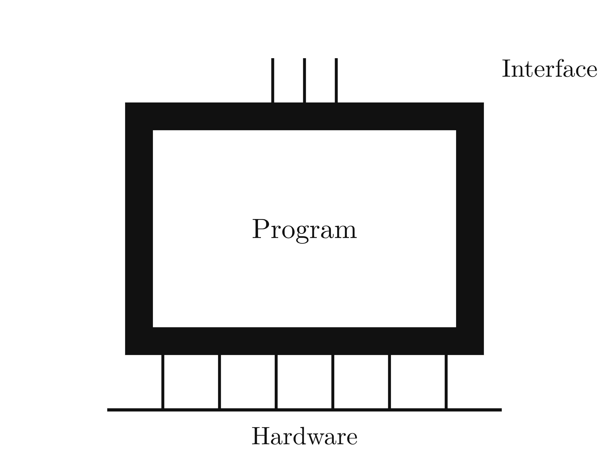
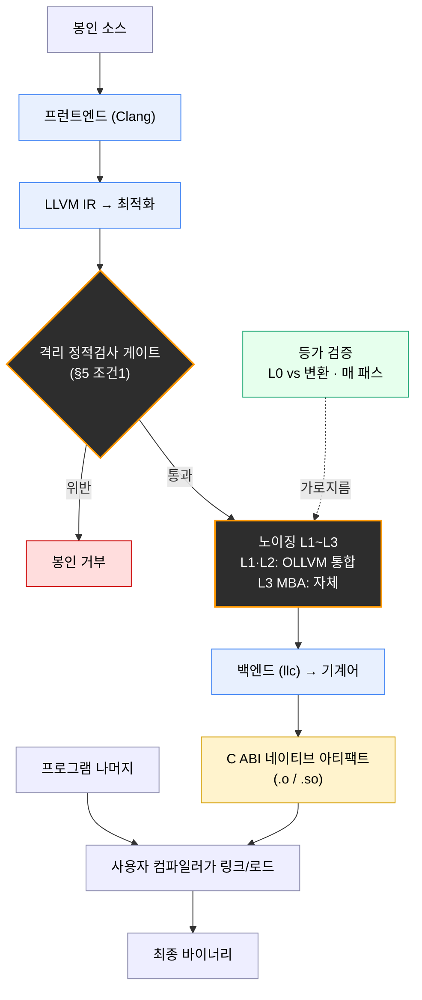

# Black-Shell 기획안

작성일: 2026-10-17

> 프로그램 전체가 아니라 "절대 공개되면 안 되는 핵심 구간"만 골라, 외부와 값으로만 소통하는 격리된 검은 상자로 봉인하는 빌드 단계 보호 도구.

---

## 1. 개요

Black-Shell은 프로그램 전체가 아니라 "절대 공개되면 안 되는 핵심 구간"만 골라, 외부와 값으로만 소통하는 격리된 검은 상자로 봉인하는 빌드 단계 보호 도구다. 하드웨어가 실행하는 명령어 집합(ISA)은 건드리지 않고, 우리가 통제할 수 있는 소프트웨어, 즉 그 하드웨어에 먹일 명령어 스트림만 변환한다.

배경은 AI 기반 역분석의 대중화다. AI 역분석 도구가 기존 디스어셈블러·디컴파일러를 AI 에이전트와 묶어, 과거 전문가가 수작업으로 하던 분석을 자동화하면서 역공학 비용이 급격히 낮아지고 있다. 방어선을 다시 그어야 하는 시점이다.

이 프로젝트가 정직하게 내거는 목표와 한계는 이렇다.

- **막으려는 것**: 코드를 읽어 로직을 그대로 재사용하는 공격의 비용을 극대화하고, 재구성된 프로그램을 관측 밖 영역에서 확정 불가능(indeterminate)하게 만든다.
- **막지 못하는 것**: 관측 가능한 입출력 동작 자체. 프로그램이 CPU에서 실행되는 이상 명령어와 경계의 입출력은 노출되며, 완전 차단은 원리적으로 불가능하다. 따라서 목표는 "분석 불가능"이 아니라 "재사용 불가능 + 재구현 비용 극대화"다.

**타깃과 범위.** 1차 타깃은 두 층이다. (1) 자신의 비밀 알고리즘이 베껴지는 것을 막으려는 1인·소규모 개발자, (2) 유포 방지 위에 복사 방지 레이어를 더하려는 기업. Black-Shell은 유포 방지(불법복제·탬퍼)를 노리지 않는다 — 그건 기존 프로텍터가 쉘과 인근을 감싸 처리하고, Black-Shell은 핵심 로직의 복사·재구현을 막는 별도 레이어로 그 위에 합성된다. 실제 구현은 ISA 중립적인 컴파일러 중간 표현(IR) 계층에서 이뤄져 멀티 타깃을 지원한다.

---

## 2. 위협 모델

공격자는 봉인된 실행 파일을 완전히 손에 쥐고 있으며, 다음 능력을 조합해 사용한다. 각 능력은 서로 다른 것을 겨냥하기 때문에, 방어를 한 가지로 설계하면 다른 경로로 뚫린다.

| 공격 능력 | 겨냥하는 것 | Black-Shell의 대응 |
| --- | --- | --- |
| 정적 분석 (디스어셈블·디컴파일) | 코드를 읽어 구조·로직 파악 | 명령어 꼬기로 읽기 비용 극대화 (주 전장) |
| 동적 추적 (디버거·트레이스) | 실행 경로의 명령어 시퀀스 | native 실행이라 직접 차단 불가, 안티디버깅으로 비용만 |
| 경계 샘플링 (입출력 관측) | 동작 f 자체 | 클라이언트 기법으로는 불가 — 자격 조건(§5)으로 회피 |
| 심볼릭 실행·SMT | 모든 입력에 대한 f (의미적 복원) | 경로 폭발·큰 제약 공간으로 비용 극대화 |
| AI 역난독화 | 가장 단순한 등가 프로그램 합성 | f의 고유 복잡도가 낮으면 못 막음 — 자격 조건으로 |

핵심은 공격자가 반드시 "명령어를 전부" 분석할 필요가 없다는 점이다. 동작 f만 필요하면 경계만 때리면 되고, 그럴 때 명령어 꼬기는 무의미해진다. 따라서 위협 모델의 무게중심은 "경계 샘플링을 얼마나 어렵게 만드느냐"에 있다.

---

## 3. 이론적 토대

이 프로젝트의 질문은 하나다 — "의미를 보존하는 변환은 원리적으로 되돌릴 수 있는가." 여럿 가능 이론이 이 질문을 서로 다른 각도에서 답한다.

**(1) 두 방향의 가역성.** "되돌린다"는 말에는 두 방향이 있다. 방향 A는 데이터 역산(실행 상태를 거꾸로 돌려 과거를 복원), 방향 B는 코드 복원(동작에서 로직을 재구성). 사용자가 처음 떠올린 "40→42가 +2인지 모른다"는 A에 관한 것이고, REA가 하는 일은 B다. 둘은 독립이다.

**(2) 난독화 불가능성 — VBB와 iO.** Barak 등(2001)은 이상적 난독화, 즉 가상 블랙박스(VBB) 성질("난독화된 코드에서 얻을 수 있는 것 = 입출력만 관찰해 얻는 것")이 **불가능**함을 증명했다. 난독화기가 비다항시간이어도, 기능을 근사만 보존해도 불가능이 유지된다. 반면 더 약한 목표인 구별 불가능 난독화(iO) — "같은 기능의 두 구현을 난독화하면 구별 불가" — 는 낱북 가정(well-founded assumptions) 위에서 구성 가능함이 밝혀졌다(Jain·Lin·Sahai 2021). iO는 로직을 완전히 숨기진 못해도 "어떤 구현에서 왔는지"를 숨긴다. Black-Shell의 "재사용 차단"과 정확히 같은 정신이다.

**(3) Rice 정리.** 프로그램의 비자명한 의미적 성질을 일반적으로 판정하는 알고리즘은 없다. 그래서 역난독화 도구는 완전할 수 없고 반드시 휴리스틱에 의존한다. 특정 휴리스틱이 못 푸는 형태를 만들면 그 도구는 막히지만, 새 휴리스틱이 나오면 또 뚫리는 군비경쟁이다.

**(4) 가역 계산 — Bennett·Landauer.** Landauer 원리: 정보를 파괴하는(비가역) 연산은 반드시 에너지를 소산한다(비트당 최소 kT ln2). Bennett(1973): 모든 계산은 버려질 정보를 history 테이프에 남기면 가역 튜링 기계로 시뮬레이션된다. 즉 비가역성은 선택이고, 흔적(garbage)의 유무가 복원 가능성을 가른다. 단, 비가역 설계는 스냅샷 공격(나중 상태→과거 역산)만 막고, 실시간 트레이싱은 못 막는다.

**(5) 입출력에서 f 추론.** 관측이 (a,b) 쌍뿐일 때 f를 추측할 수 있는가는 f의 성질이 결정한다. 가정이 없으면 관측 밖은 미결정(no free lunch). A가 작아 전수 질의 가능하면 룩업 테이블로 완전 복원(Angluin의 질의 학습이 이 구조를 형식화한다). f가 단순·구조적이면 PAC 학습으로 적은 샘플로 근사되고, Occam/MDL에 따라 공격자는 가장 단순한 등가물을 합성한다. 현실의 코드 대부분이 여기 들어가며, AI는 본질적으로 강력한 Occam 엔진이다.

**(6) MBA와 역난독화의 현주소.** Mixed Boolean-Arithmetic은 산술과 비트 연산을 섞어 단순 연산을 숨긴다. 어느 한 도메인의 단순화기도 혼합식을 혼자 검증 못해 어렵다. 그러나 최근 자동 역난독화 연구가 앞서 있어, 표준적인 MBA는 대부분 자동으로 단순화된다(한 최근 연구는 대규모 식 집합의 99%대를 단순화). 남은 저항 영역은 캐리가 얽히는 혼합 도메인과, 부분식 중복으로 단순화기의 예산을 고갈시키는 식이다. 방어는 이 사각을 노려야 한다.

**(7) 심볼릭 실행과 경로 폭발.** 가장 강력한 의미적 공격은 구문을 안 건드리고 심볼릭 실행으로 입출력 관계를 추출해 최소 등가식을 합성한다. 그러나 이 기법의 1순위 실무 한계가 경로 폭발이다 — 분기 n개면 경로가 2^n으로 늘고 각 경로의 제약을 SMT로 풀어야 해 비용이 터진다. 단, 상태 병합 같은 완화 기법이 있어 분기 수만 늘리는 건 부족하다.

**(8) 일방향 함수.** "앞은 쉽고 뒤는 불가능"의 엄밀한 형태. f가 단사여서 역함수가 존재해도 계산이 불가능하면 된다. 의사난수 함수(PRF)는 다항개 (a,b)를 관측해도 질의하지 않은 점의 f를 진짜 난수와 구별 못 하게 한다. VBB가 불가능으로 증명된 것과 달리, 일방향 함수는 존재가 폭넓게 받아들여진다 — 즉 f를 추측 불가로 만드는 유일하게 증명 가능한 길이다.

---

## 4. 핵심 통찰

f는 경계에 산다. 입력 a와 출력 b, 그 사이 경계의 매핑이 f이고, 그 안에서 명령어가 몇 개 돌았는가는 경계에서 보이지 않는다. 이 한 문장이 설계 전체를 지배한다.

여기서 세 가지 결론이 따라나온다.

1. **명령어 부풀리기는 경계 샘플링을 못 막는다.** 같은 f를 계산하면 명령어가 10개든 100억 개든 경계에서 구별되지 않는다. 공격자는 상자를 블랙박스로 두고 a를 넣어 b를 받으면 된다. 이 샘플링 공격에는 내부 명령어 수가 완전히 무관하다.
2. **공격자는 당신의 프로그램이 아니라 가장 단순한 등가물을 복원한다.** 당신 구현의 크기는 부풀릴수록 커지지만, f의 고유 복잡도(Kolmogorov 복잡도, 그 동작을 내는 가장 짧은 프로그램의 길이)는 그대로다. 부풀리기는 둘 사이 간극만 키울 뿐, 공격자의 표적(고유 복잡도)을 전혀 안 움직인다.
3. **부풀리기는 샘플링이 불가능할 때만 유효하다.** 명령어 수가 비용이 되는 건 오직 공격자가 경계를 못 때려 명령어를 통과할 수밖에 없을 때다. 즉 입력 공간이 커서 샘플링으로 못 덮으면, 공격자는 심볼릭 실행을 강요당하고, 그제서야 부풀린 명령어와 분기가 경로 폭발로 값어치를 한다.

그래서 모든 방어가 한 점으로 수렴한다 — **열거 불가능한 큰 입력/조건 공간.** 사용자의 분기 아이디어(분기를 늘려 확정 불가능하게)도, 샘플링 내성 조건도, 명령어 부풀리기도 결국 "공격자가 커버할 수 없는 큰 공간"이라는 하나로 귀결된다. 분기 조건을 열거 불가능한 공간에 묶으면 — 관측 밖 영역이 미결정으로 남고(휴면 분기), 심볼릭 실행에 경로 폭발을 강제한다 — 두 효과가 동시에 난다.

따라서 설계 원칙의 순서가 정해진다. **먼저** 봉인 구간을 "입력/조건 공간이 커서 샘플링 불가"한 구간으로 고르고, **그 위에** 명령어 부풀리기를 얹는다. 순서가 반대면 — 작은 공간에 부풀리기만 — 공격자가 경계로 우회해 전부 헛수고가 된다.

---

## 5. 봉인 자격 조건

모든 구간이 봉인 대상이 될 수는 없다. 봉인이 의미를 가지려면 두 조건을 동시에 만족해야 하고, 이 둘은 서로 긴장 관계에 있다.

**조건 1 — 외부 메모리 비공유 (격리 가능성).** 봉인 구간은 외부와 값으로만 소통해야 한다. 자기 스택 프레임만 쓰고, 전역·힙을 가리키는 포인터를 받지 않고, 입출력은 값 복사로만. 순수 함수 성질이다. 공유 상태가 없으니 경계에서 보존·복원할 게 입출력으로 좁혀지고, 빌드 단계 정적 검사로 위반 시 봉인을 거부할 수 있다.

**조건 2 — 샘플링 내성.** 입력/조건 공간이 커서 경계 샘플링으로 f를 복원할 수 없어야 한다. 이게 핵심이고, 여기에 역설이 있다 — 조건 1의 순수 함수화는 격리를 쉽게 만들지만, 바로 그 이유로 입출력 쌍을 깨끗이 뽑기도 쉬워져 샘플링 공격에 취약해진다. 그래서 격리 용이성과 샘플링 취약성을 함께 저울질해야 한다.

좋은 봉인 대상과 나쁜 대상이 여기서 갈린다.

| | 좋은 대상 | 나쁜 대상 |
| --- | --- | --- |
| 입력 공간 | 사실상 무한, 전수 불가 | 작아서 전수 질의 가능 |
| 입출력 관계 | 복잡, 적은 샘플로 못 맞춤 | 단순(사칙연산·정렬) |
| 가치의 위치 | 내부 구현의 정교함 | 입출력만 보면 뻔함 |
| 예시 | 큰 상태를 복잡하게 변환하는 핵심 알고리즘 | x+2, 두 값 비교 |

이상적인 대상은 입출력만 보면 뻔하지만 내부 알고리즘이 정교한 구간이다. 한 문장으로: **봉인 대상은 입력/조건 공간이 열거 불가능하게 커서 경계 샘플링으로 f를 복원할 수 없는 구간이어야 하며, 명령어 부풀리기는 그 전제 위에서만 유효한 2차 수단이다.**

**집행 규칙 — Call-by-value.** 조건 1은 다음 규칙으로 집행한다. 봉인 구간의 내부 인터페이스는 (1) 포인터 없는 값의 깊은 복사로만 입출력하고(얕은 복사 속 포인터 금지), (2) 외부 전역·정적·I/O에 접근하지 않는다. 내부 구현 패러다임(OOP·절차·함수형)은 자유이되, 모든 상태는 구간 전용 메모리에 완결돼야 한다. 이 계약은 IR 수준에서 정적 검사 가능하며, 위반 시 봉인을 거부한다. 참고: 입력 '공간'(경우의 수, 조건 2)과 입력 '크기'(복사 바이트)는 다르다 — 16바이트 키처럼 작게 복사되면서 공간이 거대한 값이 이상적이다.

---

## 6. 기술 아키텍처

**그림 1. Black-Shell 개념도.** 검은 상자(Shell)가 핵심 Program을 감싼다. 위쪽 Interface 핀은 외부와 오직 값(call-by-value)으로만 소통하는 경계로, 공유 메모리·전역·I/O 누출을 차단한다(축 1, 외부 차단). 아래쪽 Hardware 버스는 봉인 구간이 VM 없이 네이티브로 실행됨을 나타낸다. 상자의 검은 테두리 안쪽, 즉 Program 내부가 의미 보존 변환으로 불투명해지는 영역이다(축 2, 내부 노이징).

하드웨어가 실행하는 것(ISA)은 그대로 두고, 그 하드웨어에 먹일 명령어 스트림만 변환한다. VM/바이트코드 방식과 달리 CPU가 진짜 기계어를 native 속도로 돌린다.

**설계의 두 축.** 가공은 두 축으로 나뉜다. (축 1) 외부와의 차단 — 경계를 call-by-value 값 채널로 좁혀 공유 메모리·전역·I/O 누출을 없앤다(§5). 이 축이 경계 샘플링·동작 학습을 상대한다. (축 2) 내부에서의 노이징 — 봉인 구간 내부를 L1~L3로 꼬아 정적 읽기와 심볼릭 실행 비용을 올린다. 두 축은 비대칭이다 — 축 1이 공격자를 내부로 몰아넣어야 축 2가 값어치를 가진다. 그래서 '외부 차단 먼저, 내부 노이징은 그 위에'가 고정 순서다. 개발자 규칙은 두 줄로 선다 — 내부는 아무 패러다임이나 자유(단 상태는 구간 전용 메모리에 완결), 경계는 call-by-value·전역/I/O 금지.

**중간 표현(IR) 계층에서의 변환.** raw 명령어 바이트를 ISA마다 직접 주무르는 건 유지보수 지옥이므로, 변환은 컴파일러 중간 표현(IR) 계층에서 한 번 작성해 백엔드가 여러 타깃으로 내려주게 한다. 'native 실행 유지'는 'ISA는 백엔드에 맡기고 우리는 IR만 변환한다'로 번역된다. 단 겹친 디코딩 같은 ISA 특유 트릭은 IR에선 못 쓰므로, 극소수 구간만 타깃별 후처리로 얹는 2단 구조를 둔다.

**구현 파이프라인 (2026-10-30 확정).** 개입 층을 소스·바이너리가 아니라 **IR 레벨**로 못 박는다. 소스 레벨은 사용자 최적화기가 노이징을 도로 풀어버리고, 바이너리 레벨은 위의 ISA별 유지보수 지옥에 바로 떨어지기 때문이다. 구체 파이프라인은 다음과 같다.

**그림 2. 구현 파이프라인.** 주황 테두리(검정 배경) = **우리가 작성**(격리 게이트·노이징·등가 검증), 파랑 = **LLVM 부품**(프런트엔드·최적화·백엔드), 노랑 = **출력 아티팩트**(C ABI). 게이트는 노이징 앞의 go/no-go이고, 노이징은 최적화기 뒤에 꽂힌다. 등가 검증은 변환 전체를 가로지르는 안전망이며, C ABI 아티팩트가 사용자 컴파일러와의 독립 이음매다.

★ 표시 두 단계만 우리가 작성하고, 프런트엔드·최적화·백엔드(= C 파싱과 기계어 생성의 거대한 부분)는 LLVM 부품을 빌려 쓴다. LLVM은 노이징을 하지 않는다 — 핵심 IP는 전부 우리 패스다. 선례로 **OLLVM(Obfuscator-LLVM)**이 같은 구조(LLVM에 난독화 패스 삽입)를 증명해 두었다.

**빌드 범위 분담 — OLLVM과의 관계.** OLLVM(및 Hikari·Pluto·Arkari 등 포크)이 이미 L1~L2(명령어 치환·가짜 제어흐름·평탄화)를 구현해 두었고, 이는 커머디티다. 따라서 그 계층은 **새로 짜지 않고 포크를 통합해 빌려 쓴다**(부록 A 3번). 우리가 직접 작성하는 것은 ① 파이프라인 척추(패스 계약·드라이버·토글·등가 검증 하네스), ② **L3 carry-sensitive MBA**(§3에서 보듯 표준 MBA는 자동 해제되므로), ③ **봉인 자격 분석기**(§5), ④ **재사용성 벤치마크**(§9 페이즈3)다. 즉 OLLVM의 존재는 위협이 아니라 빌드 범위를 줄여 주는 호재이며, Black-Shell은 '또 하나의 난독화기'가 아니라 자격(어떤 구간이 봉인할 가치가 있나)과 측정(봉인 후 재사용 불가성)으로 차별화한다(§8).

**사용자 컴파일러 독립 — C ABI 이음매.** 봉인 유닛은 *우리가* 번들한 LLVM으로 자급자족 컴파일하고(모델 P), 결과를 **C ABI 네이티브 아티팩트**로 돌려준다. 사용자는 자기 컴파일러(gcc·clang·msvc 무엇이든)로 나머지를 빌드하고 그 아티팩트를 링크/로드만 한다 — 봉인 유닛만 우리 경로를 타고 나머지는 평소대로. 이 이음매가 보안 속성(축 1 외부 차단)이면서 동시에 이기종 툴체인을 공존시키는 **통합 메커니즘**이다. §5의 call-by-value 경계가 곧 C ABI 값 전달 경계라 이음매가 가장 호환 좋은 지점에 떨어진다. (대안으로 사용자가 빌드한 바이너리를 재작성하는 모델 Q, 사용자 컴파일러에 플러그인으로 들어가는 GCC 플러그인 방식은 각각 바이너리 레벨 지옥·단일 컴파일러 종속으로 기각.)

**언어 슬롯 셋.** IR 결정이 '구현 언어' 질문을 세 슬롯으로 분해한다. ① **봉인 소스** = LLVM 프런트엔드가 있는 언어(현실적으로 C/C++, 이후 Rust) — 사용자가 비밀 로직을 쓰는 언어. ② **호스트 프로그램** = 아무거나(우리 입력이 아님, C ABI로 아티팩트를 부르기만). ③ **BlackShell 구현** = LLVM API가 C++이라 C++ 기본, 또는 바인딩(Python·Rust). 봉인 대상만 ①의 제약을 받고 전체 앱은 언어 자유다.

봉인 강도는 레벨로 나누고, 아래로 갈수록 읽기 어려움과 비용이 함께 커진다. 독립적으로 켜고 끌 수 있게 해 구간별로 조합한다.

| 레벨 | 변환 | 주 방어 대상 | 비용 |
| --- | --- | --- | --- |
| L0 | 원본 (기준선) | — | 없음 |
| L1 | 명령어 치환·확장, 더미 삽입, 재배치 | 정적 패턴 매칭 | 코드 크기 소폭 ↑ |
| L2 | 간접 분기, 불투명 술어, 제어흐름 평탄화 | CFG 복원 | 분기 비용 ↑ |
| L3 | MBA (산술·논리를 등가 복잡식으로, 중첩) | 의미적 단순화·심볼릭 | 연산량 크게 ↑ |

L3는 연산량이 크게 늘어 봉인 구간에만 선택적으로 적용한다. 다만 §3에서 보듯 표준 MBA는 이미 대부분 자동 해제되므로, carry-sensitive 혼합·부분식 중복을 노리는 생성기가 필요하다.

**비용 모델.** 전체 성능 영향 = 보호 구간 비중 × 봉인 강도. 각 레벨의 코드 크기 배율과 실행 시간 배율을 측정해 사용자가 저울질할 근거를 준다.

**정확성 검증.** 모든 변환은 빌드마다 L0과 같은 입력에 같은 출력을 내는지 자동 비교한다. 이게 깨지면 변환 패스가 잘못된 것이다.

---

## 7. 한계와 정직한 평가

이 도구가 과장되지 않으려면 몇 가지 한계를 명시해야 한다.

- **VBB는 불가능이 증명되어 있다.** "완전한 미지의 검은 상자"의 가장 강한 버전은 수학적으로 도달 불가능하다. 더 약한 iO가 현실적 천장이다.
- **의미 보존 변환은 원리적으로 가역이다.** 명령어 꼬기(MBA 포함)는 결과가 같으므로 단순화로 되돌릴 수 있다. 올리는 건 "비용"이지 "불가능성"이 아니다.
- **동적 추적엔 약하다.** native 실행이라 명령어를 한 스텝씩 따라가면 각 연산의 의미가 확정된다. 명령어 꼬기로는 못 막고 안티디버깅 같은 보조 수단에 의존한다.
- **샘플링은 명령어와 무관하다.** §4의 결론처럼, 입력 공간이 작으면 어떤 변환도 소용없다.

그래서 목표는 "분석 불가능"이 아니라 **확정 불가능(indeterminate) + 재구현 비용 극대화**다. 공격자가 들일 노력이 그 구간을 뚫어서 얻는 가치보다 커지는 지점, 거기가 실질 방어선이다.

한 가지 정직한 분기점도 기록해 둔다. 동작 f 자체를 증명 가능하게 숨기는 유일한 길은 봉인 핵심 비밀을 일방향 함수·PRF에 묶는 것. 명령어 꼬기 노선은 이 격상에는 닿지 못하고, "정적 읽기를 비싸게"에 머문다. 프로젝트 범위를 (1) 명령어 꼬기에 한정할지, (2) 암호학적 봉인으로 격상할지는 열린 결정이다.

---

## 8. 관련 연구 및 기존 도구

Black-Shell은 새 영역이 아니라 성숙한 분야 위에 선다. 차별점은 "AI 역분석 결과의 재사용성을 떨어뜨린다"는 포지셔닝에 있다.

- **상용 보호 솔루션** — 코드 가상화·패킹으로 보호하는 상용 제품군이 있으나, 닫혀 있고 비싸며 native 속도를 크게 희생하는 가상화 중심이다.
- **오픈소스 난독화** — 제어흐름 평탄화·명령어 치환 등을 제공하는 공개 난독화기들이 있다. Black-Shell의 L1~L2는 이들과 겹치므로, 차별은 봉인 자격 조건과 재사용성 측정에서 나와야 한다.
- **MBA 역난독화 연구** — 자동 단순화가 앞서 있어 표준 MBA는 대부분 풀린다. 방어자는 그 연구가 못 푸는 영역(캐리가 얽히는 혼합)을 역으로 노려야 한다.
- **학술 의미적 역난독화** — 심볼릭 실행과 프로그램 합성이 최전선이다. 설계는 이들을 가상의 공격자로 삼아 방어 수준을 측정해야 한다.

차별점 요약: 기존 도구가 "코드를 얼마나 읽기 어렵게 만드느냐"에 먼다면, Black-Shell은 "어떤 구간이 애초 봉인할 가치가 있는가(자격 조건)"와 "봉인 후 역분석 결과가 얼마나 재사용 불가해졌는가(측정)"를 앞세운다.

---

## 9. 로드맵과 1차 구현 범위

1차 목표는 "개념이 실제로 돌아간다"를 증명하는 것이다. 화려한 변환보다 경계와 검증 루프를 먼저 세운다.

**페이즈 1 — 미니멀 골격 (개념 증명).**

1. 작은 명령어 서브셋 인터프리터 (산술, 로드/스토어, 분기 몇 개)
2. 봉인 구간이 외부 메모리를 공유하지 않는지 검사하는 정적 체커 (위반 시 거부)
3. 통과한 구간을 값 경계로 격리해 자기만의 메모리에서 실행하는 러너
4. 원본 직접 실행 vs 격리 실행의 결과 일치 검증

**페이즈 2 — 변환 파이프라인.** L1(치환·더미·재배치) → L2(간접 분기·불투명 술어·평탄화) → L3(MBA)를 패스로 하나씩 얹는다. 각 패스는 켜고 끌 수 있고, 매 패스마다 결과 일치 검증을 통과해야 한다.

**페이즈 3 — 측정법 (d).** 봉인 전후에 AI 역분석 도구·디컴파일러·심볼릭 실행기를 돌려, "뽑은 결과가 그대로 컴파일·동작하는가(재사용 가능성)"를 지표로 수치화한다. 보호 전: 코어가 바로 재구현 가능 → 보호 후: 뽑은 결과가 외부에서 안 돌아감. 이 지표가 프로젝트의 차별점이자 검증 수단이다.

**구현 접근.** 1차는 프로토타이핑과 정확성 검증이 쉬운 환경에서 개념을 먼저 돌리고, 성능이 필요한 부분만 이후에 옮긴다. 구체적으로 **PoC는 LLVM 없이** 작은 명령어 서브셋 토이 IR + 우리 노이징 + 인터프리터로 가볍게 돌리고(이 단계는 네이티브·멀티ISA가 목표가 아니라 인터프리트가 허용됨), 개념이 증명되면 §6의 LLVM 파이프라인으로 올린다. 이때 PoC 코드가 버려지는 게 아니라 — 파이프라인 모양·등가 검증 하네스·게이트 규칙(§5)은 그대로 넘어가고, 다시 쓰는 건 IR을 실제로 만지는 패스 몸통뿐이다.

**관리 전략 — 워킹 스켈레톤(계층형).** 끝에서 끝까지 파이프라인을 **더미(항등 패스)로 먼저** 뚫어 초록불을 만든 뒤, 더미를 실제 패스로 하나씩 교체한다. LLVM 자체가 패스 파이프라인이라 이 방식과 1:1로 맞는다. 먼저 고정할 '척추' 셋: (1) **패스 계약** `IR→IR`(노이징)·`IR→{통과|거부}`(게이트) — 더미와 실제가 같은 계약이어야 무중단 교체, (2) **드라이버+토글**(§6의 레벨 on/off), (3) **등가 검증 하네스**(더미 단계부터 안전망). 빌드 순서는 ① 드라이버+검증 하네스 → ② 더미로 끝-끝 초록불 → ③ 더미를 실제로 교체(매 교체를 등가 검증이 지킴, L1→L2→L3→게이트 순). 주의: 더미 *노이징*은 '정확하지만 보호 안 됨'이라 안전하지만, 더미 *게이트*(accept-all)는 '봉인됨'이라는 거짓 확신을 주므로 출하 전 반드시 실제로 교체한다.

**열린 결정.** 클라이언트 측 단독으로 둘지 서버 연동(§7의 암호학적 격상)까지 범위에 넣을지.

---

## 부록 A. 오픈소스 전략과 포지셔닝

엔터프라이즈 보호 '제품' 시장은 이미 성숙한 상용 솔루션들로 포화다. 그래서 Black-Shell은 그들과 경쟁하지 않고, 그들이 안 덮는 빈칸과 레이어를 노린다.

**유포 방지가 아니라 복사 방지.** 유포 방지(불법복제·탬퍼·라이선스)는 기존 프로텍터가 쉘과 인근을 감싸 처리한다. Black-Shell은 핵심 로직의 추출·재구현(복사)을 막는 별도 레이어로, 그 결과물을 기존 프로텍터가 다시 패킹한다 — 대체가 아니라 합성. 이 프레이밍의 이점: 기업이 기존 투자를 안 버려도 되니 채택 장벽이 낮고, 도구의 실제 강점(코드 이해 비용↑)이 복사 방지 니즈와 정렬되며, 'AI(REA)가 네 핵심 IP를 베낀다'는 선명한 메시지가 선다.

**두 타깃.**

- 1인·소규모 개발자: '네 비밀 알고리즘을 AI가 베끼는 걸 막아라.' 단 라이선스 크랙 방지로 과대포장하지 말 것(패치 공격엔 약함), 한 줄 빌드 + 자동 후보 탐지로 사용성 장벽을 없앨 것.
- 기업: 유포 방지 위에 얹는 복사 방지 레이어. OSS 코어 + 유료 서비스(통합·측정 리포트).

**세 컴포넌트 (가치 순).**

1. AI 역분석 저항 벤치마크 — 가장 방어 가능·공공재적, 표준 부재 영역. 프로젝트의 얼굴.
2. 봉인 자격 분석기 — call-by-value/격리 정적 체커 + '봉인 가치' 조언. 자동 후보 탐지의 핵심.
3. 봉인 엔진 — 새로 짜기보다 기존 오픈소스 난독화 엔진을 통합·활용. 화이트박스·하드웨어 격리는 상위 옵션으로 안내.

**이중 용도 주의.** 분석 저항 도구는 멀웨어를 끌어들인다. 공격 기법이 아니라 방어 측정(벤치마크)을 얼굴로 두고, 엔진의 악용을 조장하지 않는 거버넌스가 필요하다.

---

## 10. 참고문헌

- [Barak et al., On the (Im)possibility of Obfuscating Programs (2001)](https://www.boazbarak.org/Papers/obfuscate.pdf)
- [Jain, Lin, Sahai, Indistinguishability Obfuscation from Well-Founded Assumptions (2021)](https://ar5iv.labs.arxiv.org/html/2008.09317)
- [A Review of Modern Code Deobfuscation Techniques (HITB, Gamez Montolio)](https://conference.hitb.org/hitblockdown002/materials/D2T2%20-%20A%20Review%20of%20Modern%20Code%20Deobfuscation%20Techniques%20-%20Arnau%20Gamez%20Montolio.pdf)
- [GAMBA: Simplification of General Mixed Boolean-Arithmetic Expressions (2023)](https://arxiv.org/pdf/2305.06763)
- [A Survey of Symbolic Execution Techniques (2018)](https://arxiv.org/pdf/1610.00502)
- [Angluin, Learning Regular Sets from Queries and Counterexamples (1987)](https://www.eecs.berkeley.edu/~dawnsong/teaching/s10/papers/angluin87.pdf)

*가역 계산(Bennett 1973, Landauer 1961), Rice 정리, Kolmogorov 복잡도, PAC 학습은 표준 교과 개념으로 별도 인용 없이 기술함.*